# KTU S7 Compiler Design Laboratory Suite

<div align="center">

[](https://isocpp.org)
[](https://ktu.edu.in)
[](LICENSE)

</div>

A complete implementation of laboratory experiments for the 7th Semester Computer Science and Engineering Compiler Design Laboratory (KTU 2019 Scheme).

---

## Compilation Phases & Architecture

```mermaid
graph LR
    Source[Source Code Stream] --> Lex[Phase 1: Lexical Analyzer: Lex / C]
    Lex --> Tokens[Token Stream]
    Tokens --> Syntax[Phase 2: Syntax Analyzer: Yacc / Parser]
    Syntax --> Tree[Parse Tree / Abstract Syntax Tree]
    Tree --> Intermediate[Phase 3: Intermediate Code Generator]
    Intermediate --> ThreeAddr[Three-Address Code]
    ThreeAddr --> Opt[Phase 4: Code Optimization Engine]
    Opt --> Target[Target Assembly / Machine Representation]
```



---

## Experiments Included

| Experiment | Topic | Implementation Details |
| :--- | :--- | :--- |
| **Exp 1** | Lexical Analyzer in C | Token identification (Identifiers, Keywords, Operators, Constants) |
| **Exp 2** | Lexical Analyzer using LEX | Regular expressions for token pattern specification |
| **Exp 3** | Yacc Arithmetic Evaluator | Context-free grammar parsing and evaluation of expressions |
| **Exp 4** | Recursive Descent Parser | Top-down parsing for grammar validation |
| **Exp 5** | Operator Precedence Parsing | Shift-reduce parsing mechanism using precedence relations |
| **Exp 6** | Intermediate Code Generator | Quadruples and triples generator for arithmetic statements |
| **Exp 7** | Code Optimization | Elimination of common subexpressions and dead code |
| **Exp 8** | Target Code Generation | Assembly instruction generation from 3-address instructions |

---

## Compilation & Execution

### Running Lex and Yacc Experiments
```bash
# 1. Generate C source from Lex specification
lex lexer.l

# 2. Generate parser from Yacc specification
yacc -d parser.y

# 3. Compile generated source with GCC
gcc lex.yy.c y.tab.c -o parser -ll

# 4. Execute parser
./parser
```

### Running C-based Parser Experiments
```bash
gcc exp1/lexical_analyzer.c -o lexer
./lexer
```

---

## License

This educational repository is licensed under the MIT License. See the [LICENSE](LICENSE) file for details.
