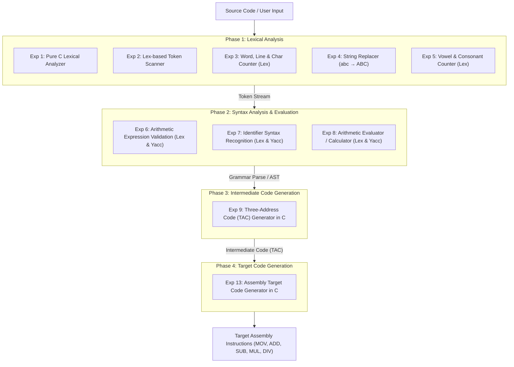
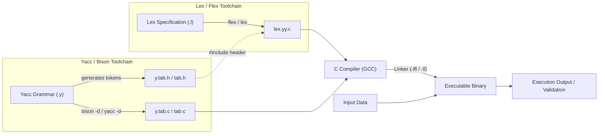

# KTU S7 Compiler Design Laboratory Suite

<div align="center">

[](https://isocpp.org)
[](https://ktu.edu.in)
[](https://github.com/Midhun-M-git/ktu-S7-CSE-CD-LAB/actions/workflows/ci.yml)
[](LICENSE)

</div>

A comprehensive implementation of laboratory experiments for the **7th Semester Computer Science and Engineering Compiler Design Laboratory (CSL411)** under APJ Abdul Kalam Technological University (KTU 2019 Scheme).

---

## 🏗️ Compiler Architecture & Lab Workflow

The experiments in this repository systematically cover each stage of traditional compiler construction, from token scanning to machine code generation.

### Compiler Phases & Experiment Mapping



---

### Lex & Yacc Compilation Pipeline Workflow



---

## 📂 Repository Structure & Experiments

| Experiment | Title | Core Technology | Description |
| :--- | :--- | :--- | :--- |
| **Exp 1** | Lexical Analyzer in C | C (Standard Library) | Scans input stream and classifies tokens into Keywords, Identifiers, Numbers, Operators, and Separators. |
| **Exp 2** | Lexical Analyzer using LEX | Lex / Flex | Uses regular expressions to scan and categorize numbers and identifiers. |
| **Exp 3** | Text Metrics Analyzer | Lex / Flex | Counts total number of words, characters, and lines from an input text stream. |
| **Exp 4** | Substring Replacement | Lex / Flex | Pattern matching that automatically replaces all occurrences of `abc` with uppercase `ABC`. |
| **Exp 5** | Vowel & Consonant Counter | Lex / Flex | Recognizes and tallies uppercase and lowercase vowels vs. consonants. |
| **Exp 6** | Expression Validator | Lex & Yacc | Context-Free Grammar (CFG) parser that checks syntactic validity of arithmetic expressions with precedence rules. |
| **Exp 7** | Identifier Recognition | Lex & Yacc | Recognizes valid variable identifier syntax according to standard programming language grammar. |
| **Exp 8** | Expression Calculator | Lex & Yacc | Syntax-directed arithmetic evaluator performing calculation on expressions with semantic actions. |
| **Exp 9** | Intermediate Code Generator | C | Reads high-level expressions and converts them into Three-Address Code (TAC) representation. |
| **Exp 13** | Target Code Generation | C | Translates intermediate instructions into machine-level assembly instructions using registers (`R0`, `R1`, etc.). |

```
ktu-S7-CSE-CD-LAB/
├── .github/
│   └── workflows/
│       └── ci.yml             # GitHub Actions CI build & verification workflow
├── exp1/                      # Lexical Analyzer in C
│   ├── lex.c
│   └── output.txt
├── exp2/                      # Lexical Analyzer using Lex
│   ├── lex.l
│   └── a.txt
├── exp3/                      # Word, line, and character counter
│   ├── words.l
│   └── algorithm.txt
├── exp4/                      # Substring replacer (abc -> ABC)
│   ├── abc.l
│   └── algorithm.txt
├── exp5/                      # Vowel and consonant counter
│   ├── vowel.l
│   └── algorithm.txt
├── exp6/                      # Arithmetic expression validator
│   ├── expr.l
│   ├── expr.y
│   └── algorithm.txt
├── exp7/                      # Identifier validator
│   ├── indenty.l
│   ├── indenty.y
│   └── algorithm.txt
├── exp8/                      # Calculator / Expression evaluator
│   ├── calc.l
│   ├── calc.y
│   └── algorithm.txt
├── exp9/                      # Three-address code generation
│   ├── tac.c
│   └── algorithm.txt
├── exp13/                     # Target code generation
│   └── targetcodegeneration.c
├── LICENSE
└── README.md
```

---

## 🚀 Compilation & Execution Guide

### Prerequisites
Make sure the following tools are installed on your system:
- **GCC** (`gcc`)
- **Flex** (`flex`)
- **Bison / Yacc** (`bison` or `yacc`)

On Ubuntu / Debian:
```bash
sudo apt-get update
sudo apt-get install -y gcc flex bison libfl-dev
```

On macOS (via Homebrew / Xcode CLI):
```bash
xcode-select --install
brew install flex bison
```

---

### 1. Running C-Based Experiments (Exp 1, 9, 13)

#### Experiment 1: Lexical Analyzer in C
```bash
gcc exp1/lex.c -o exp1_bin
./exp1_bin
```
**Sample Input:**
```c
int a = 5;
```
**Output:**
```
Keyword : int
Identifier : a
= : Operator
5 : Number
; : Separator
```

#### Experiment 9: Intermediate Code Generation (TAC)
```bash
gcc exp9/tac.c -o exp9_bin
./exp9_bin
```
**Sample Input:**
```text
a=b+c
END
```
**Output:**
```text
MOv AX,b
```

#### Experiment 13: Target Code Generation
```bash
gcc exp13/targetcodegeneration.c -o exp13_bin
./exp13_bin
```
**Sample Input:**
```text
a=b+c
exit
```
**Output:**
```text
Target code generation
Mov b ,R0
	ADD c,R0
```

---

### 2. Running Lex-Based Experiments (Exp 2, 3, 4, 5)

For Linux systems, link with `-lfl`. On macOS, link with `-ll` (or omit library flag since `yywrap` is defined in source).

#### Experiment 2: Lexical Analyzer using Lex
```bash
flex exp2/lex.l
gcc lex.yy.c -o exp2_bin
./exp2_bin
```

#### Experiment 3: Count Words, Characters, and Lines
```bash
flex exp3/words.l
gcc lex.yy.c -o exp3_bin
./exp3_bin
```
**Sample Input:**
```text
hello world
KTU CD lab
```
**Output:**
```text
Number of words = 5
Number of characters = 18
Number of lines = 2
```

#### Experiment 4: String Replacement (abc → ABC)
```bash
flex exp4/abc.l
gcc lex.yy.c -o exp4_bin
./exp4_bin
```
**Sample Input:**
```text
abc test abc
```
**Output:**
```text
ABC test ABC
```

#### Experiment 5: Count Vowels and Consonants
```bash
flex exp5/vowel.l
gcc lex.yy.c -o exp5_bin
./exp5_bin
```
**Sample Input:**
```text
Compiler
```
**Output:**
```text
number of vowel = 3
number of consonent = 5
```

---

### 3. Running Lex & Yacc Integrated Experiments (Exp 6, 7, 8)

#### Experiment 6: Arithmetic Expression Validation
```bash
cd exp6
bison -d expr.y -o expr.tab.c
flex -o lex.yy.c expr.l
gcc expr.tab.c lex.yy.c -o expr_bin
./expr_bin
```
**Sample Input:**
```text
a+b*c
```
**Output:**
```text
valid expression
```

#### Experiment 7: Valid Identifier Recognition
```bash
cd exp7
bison -d indenty.y -o indenty.tab.c
flex -o lex.yy.c indenty.l
gcc indenty.tab.c lex.yy.c -o indenty_bin
./indenty_bin
```
**Sample Input:**
```text
myVar1
```
**Output:**
```text
valid identifier
```

#### Experiment 8: Expression Evaluator / Calculator
```bash
cd exp8
bison -d calc.y -o calc.tab.c
flex -o lex.yy.c calc.l
gcc calc.tab.c lex.yy.c -o calc_bin
./calc_bin
```
**Sample Input:**
```text
15+25
```
**Output:**
```text
Result = 40
```

---

## ⚙️ Automated CI/CD Workflow

The repository includes a GitHub Actions Continuous Integration pipeline defined in [`.github/workflows/ci.yml`](.github/workflows/ci.yml). 

On every push and pull request to the `main` branch, the workflow automatically:
1. Provisions an Ubuntu environment with GCC, Flex, and Bison.
2. Compiles every pure C, Lex, and integrated Lex + Yacc experiment.
3. Executes automated smoke tests with sample inputs to ensure code correctness and build stability.

---

## 📄 License

This educational project is distributed under the MIT License. See the [LICENSE](LICENSE) file for complete terms and details.
